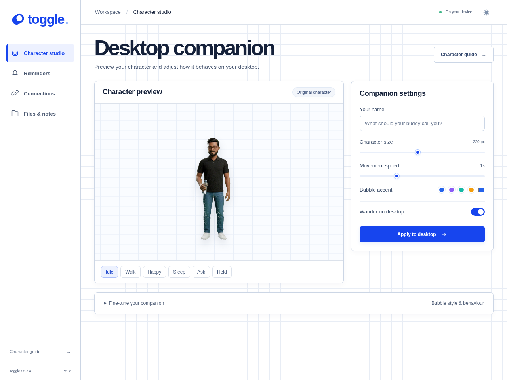

# Toggle

A personal desktop companion with a blue animated welcome, a customization studio and the original animated character. Built with Electron, JavaScript, HTML/CSS.



```sh
cd pixelfriend-v5
npm install --include=dev
npm start
```

Open **Toggle Studio** from the tray or the companion's right-click menu. Preview the original character, customize its appearance, configure reminders and use notes, file organization and approved email sending. Ollama is on hold; these studio controls do not need local AI.

- [Studio setup and character customization](docs/toggle-studio.md)
- [Google OAuth configuration and v1.1 agent reference](docs/personal-agent.md)
- [Initial source review](docs/pixelfriend-v5-analysis.md)
- [Historical original-import checksums](docs/pixelfriend-v5-sha256.json)

The source folder remains `pixelfriend-v5/` for compatibility. It is an Electron application, not Python. The original imported source and assets are available in repository history; the checksum manifest describes that initial import, not subsequent changes.
