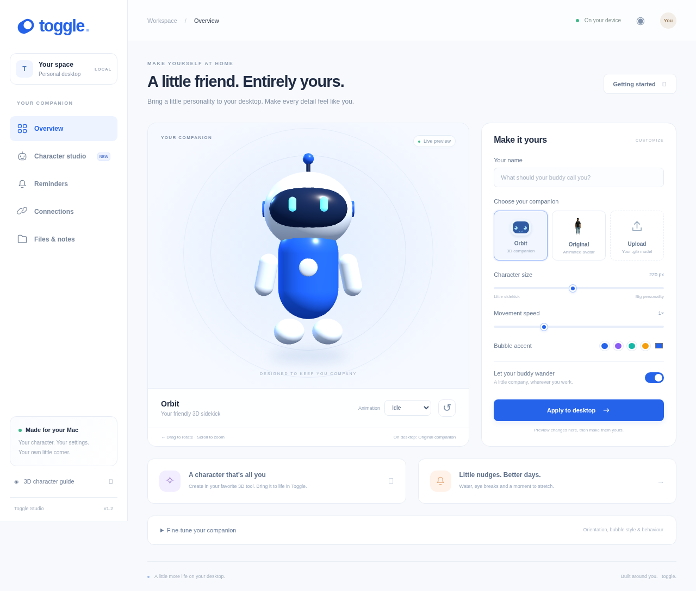

# Toggle Studio

Toggle opens with a short blue logo animation and a character studio on a white grid. The preview starts with the original animated character. Select a mood to see its built-in animation. The top navigation also opens Reminders, Connections, and Files & Notes.



Change the character's name, size, speed, bubble accent and wandering behavior, then choose **Apply to desktop**. Sound and the water progress meter are in **Companion profile**. Expand **Fine-tune your companion** for celebration laps and bubble style. In **Character image**, select the activity, then use **Choose picture or video**. The preview and the desktop use the same saved media. The change applies immediately for that activity. Use **Restore original** for the selected activity to bring back its bundled animation.

The desktop uses the original image and video avatar system. If an earlier preview build used a 3D model, Toggle resumes using the image avatar. Existing image and video overrides are kept.

## Run on your Mac

After merging the PR, update your checkout:

```sh
cd ~/doggle
git switch main
git pull --ff-only
cd pixelfriend-v5
npm install --include=dev
npm start
```

For a source checkout, run `npm run google:setup` once and choose the Desktop OAuth JSON to enable sign-in. The private registration stays in the ignored `.local` directory.

To package a Mac installer on macOS, configure the publisher’s Desktop OAuth client as described in the [release maintainer setup](personal-agent.md#release-maintainer-setup), then run:

```sh
npm run dist -- --mac dmg
open dist
```

Quit the previous app before opening Toggle. The bundle ID is retained, and Toggle reuses the previous user data folder when it exists.

## Connections and tools

Google and weather settings are under **Connections**. Choose **Sign in with Google** and approve Gmail and Calendar access in the browser, or choose **Continue as guest** at launch for local features. Local AI remains on hold. Notes, Downloads previews and manually composed email drafts work through the direct controls in **Files & Notes**. Moves and sends require approval.

## Verification

The Node test suite and Chromium smoke checks cover the original avatar preview, mood switching, desktop settings, editor entry, reminders, notes, and narrow layout. Native Mac packaging and file selection still need testing on macOS.
